# 穿云投屏 Android 客户端 (WebrtcPhone-Android)

[](https://github.com/hqw700/WebrtcPhone-Android/actions/workflows/build.yml)
[](https://kotlinlang.org)
[](https://developer.android.com)
[](https://developer.android.com/jetpack/compose)
[](LICENSE)

中文 | [English](README.en.md)

**WebrtcPhone-Android (穿云投屏)** 是基于 WebRTC 与定制 `scrcpy-server` Agent 深度打造的现代化 Android 原生云手机与物理真机控制端客户端。

本客户端是 [ScrcpyOverWebRTC (穿云投屏全平台体系)](https://github.com/hqw700/ScrcpyOverWebRTC) 的官方移动端主控应用。通过连接服务端的信令服务（Signaling Server），实现对远程 Android 物理真机（ARM64/x86）以及云手机容器（redroid / AOSP）的毫秒级低延迟超清投屏、精细化触控、文件双模管理、批量安装与租约运维。

---

## 🔗 生态与关联项目

- **Web 管理控制台与主服务体系**: 👉 [ScrcpyOverWebRTC](https://github.com/hqw700/ScrcpyOverWebRTC)  
  提供免客户端浏览器直接连接、大盘群控矩阵、安防监控控制台、信令中继以及 Docker AIO 一键部署镜像。
- **官方技术文档与社区**: 👉 [webrtc-phone.com](https://webrtc-phone.com) / [技术文档](https://webrtc-phone.com/docs/)

---

## 📱 应用界面展示 (Screenshots)

<p align="center">
  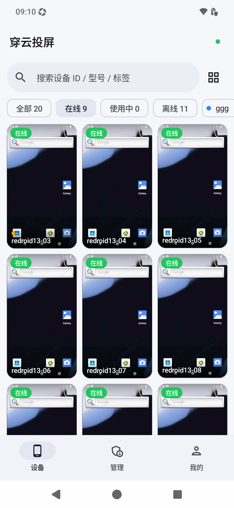
  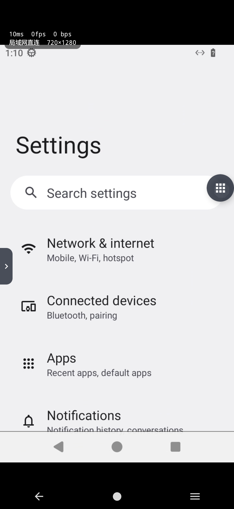
  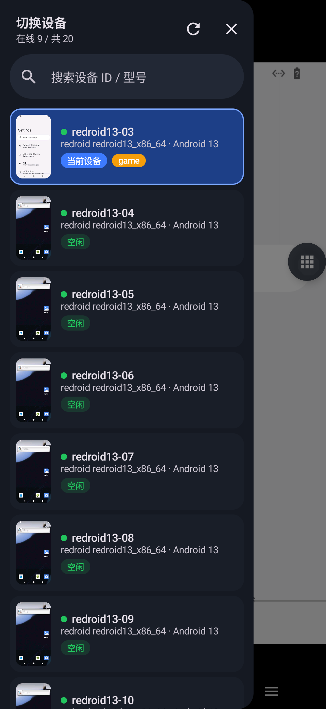
</p>
<p align="center">
  <em>图 1: 设备矩阵大盘 &nbsp;&nbsp;&nbsp;&nbsp;&nbsp;&nbsp;&nbsp;&nbsp;&nbsp;&nbsp;&nbsp;&nbsp;&nbsp;&nbsp; 图 2: 10ms 极低延迟投屏直控 &nbsp;&nbsp;&nbsp;&nbsp;&nbsp;&nbsp;&nbsp;&nbsp;&nbsp;&nbsp;&nbsp;&nbsp;&nbsp;&nbsp; 图 3: 投屏中秒级切机抽屉</em>
</p>

<p align="center">
  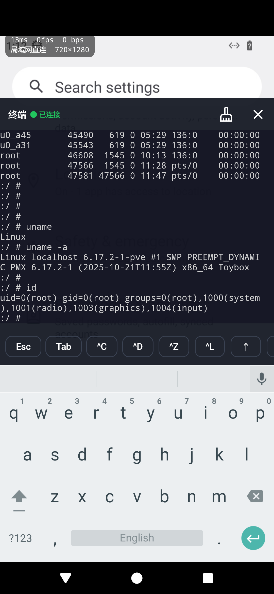
  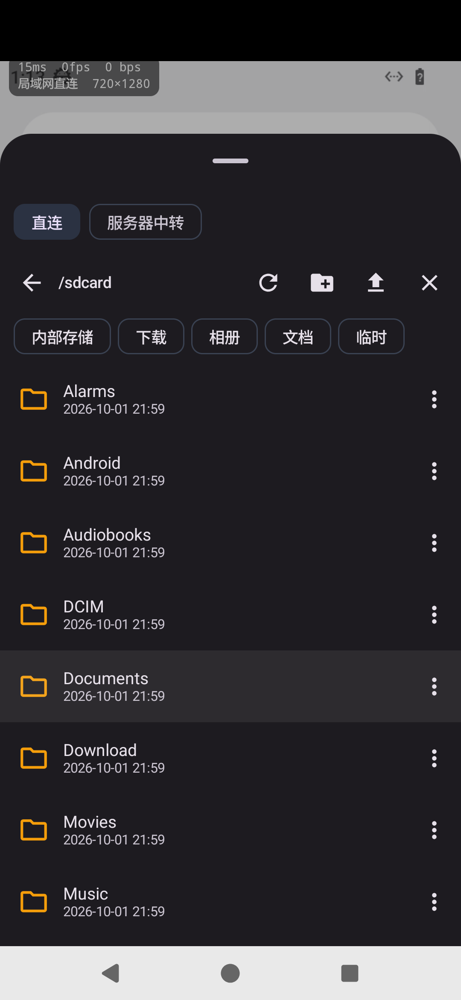
  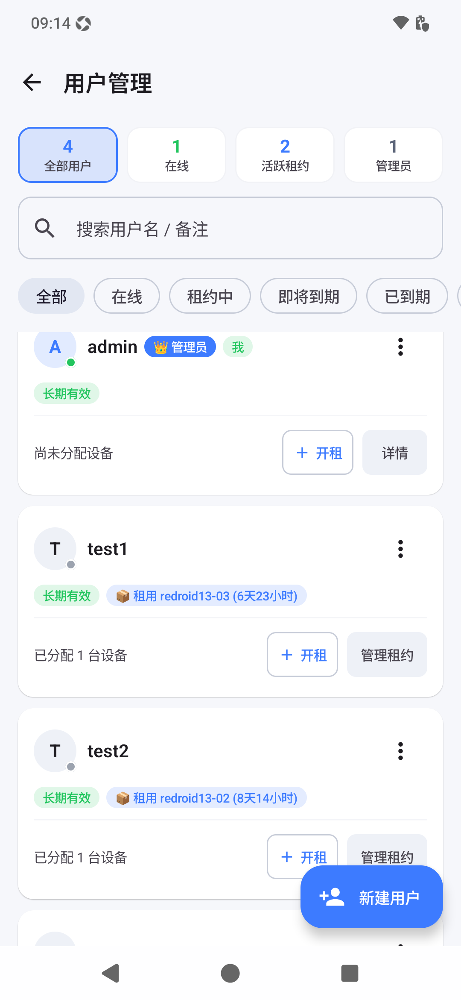
</p>
<p align="center">
  <em>图 4: WebADB 交互式终端 &nbsp;&nbsp;&nbsp;&nbsp;&nbsp;&nbsp;&nbsp;&nbsp;&nbsp;&nbsp;&nbsp;&nbsp;&nbsp;&nbsp; 图 5: 双模文件管理器 &nbsp;&nbsp;&nbsp;&nbsp;&nbsp;&nbsp;&nbsp;&nbsp;&nbsp;&nbsp;&nbsp;&nbsp;&nbsp;&nbsp; 图 6: 用户管理与设备开租</em>
</p>

<details>
<summary><b>🔍 点击展开更多界面截图（登录认证 / 全功能控制面板 / 批量文件分发 / 管理中心 / 我的设置）</b></summary>
<br>
<p align="center">
  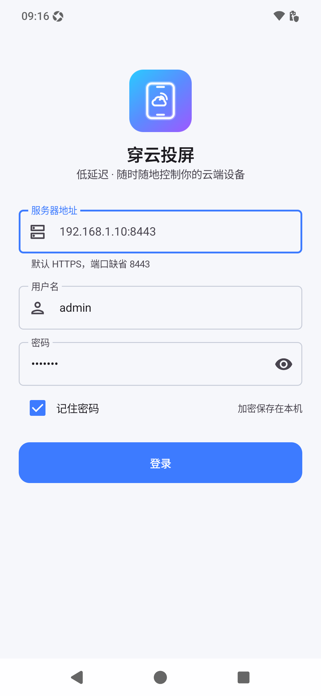
  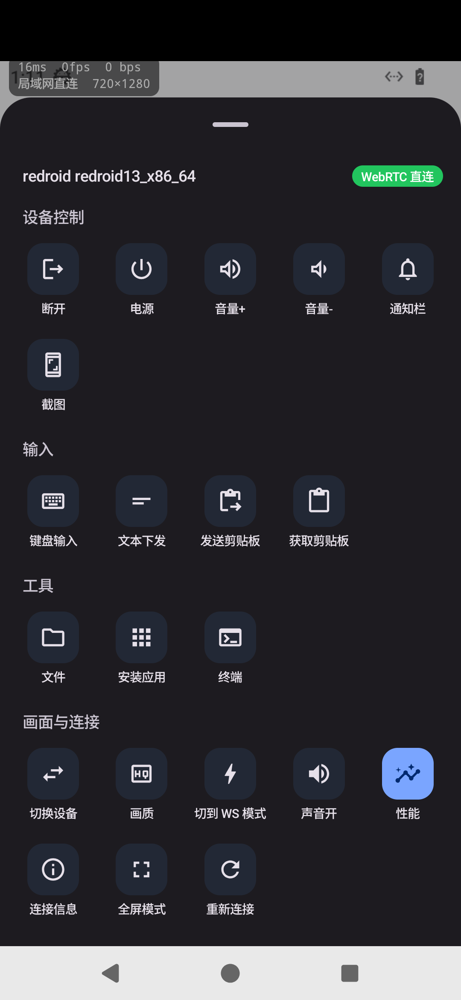
  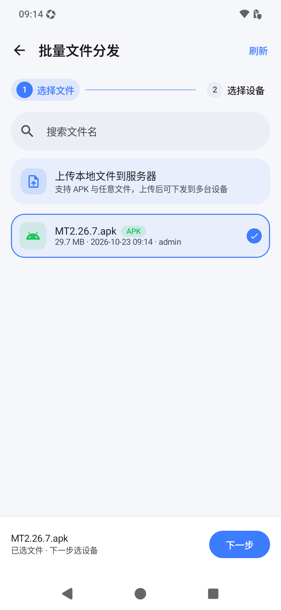
</p>
<p align="center">
  <em>图 7: 登录认证 &nbsp;&nbsp;&nbsp;&nbsp;&nbsp;&nbsp;&nbsp;&nbsp;&nbsp;&nbsp;&nbsp;&nbsp;&nbsp;&nbsp;&nbsp;&nbsp;&nbsp;&nbsp;&nbsp;&nbsp; 图 8: 全功能控制面板 &nbsp;&nbsp;&nbsp;&nbsp;&nbsp;&nbsp;&nbsp;&nbsp;&nbsp;&nbsp;&nbsp;&nbsp;&nbsp;&nbsp;&nbsp;&nbsp;&nbsp;&nbsp;&nbsp;&nbsp; 图 9: 批量文件分发向导</em>
</p>
<p align="center">
  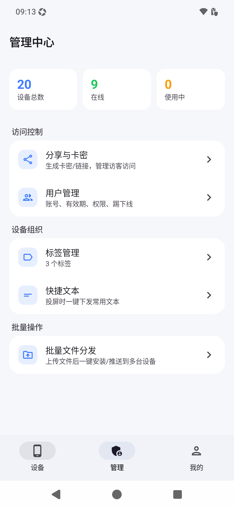
  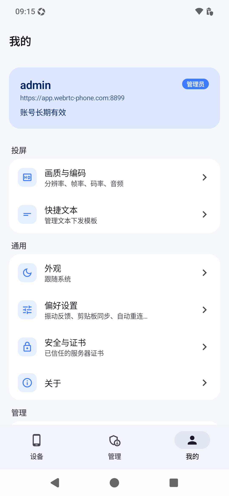
</p>
<p align="center">
  <em>图 10: 管理中心主页 &nbsp;&nbsp;&nbsp;&nbsp;&nbsp;&nbsp;&nbsp;&nbsp;&nbsp;&nbsp;&nbsp;&nbsp;&nbsp;&nbsp;&nbsp;&nbsp;&nbsp;&nbsp;&nbsp;&nbsp;&nbsp;&nbsp;&nbsp;&nbsp;&nbsp;&nbsp;&nbsp;&nbsp;&nbsp;&nbsp;&nbsp;&nbsp; 图 11: 个人设置与偏好</em>
</p>
</details>

---

## ✨ 核心特性

- **超清低延迟双通道传输**:
  - **WebRTC P2P 直连**: 基于 DTLS-SRTP 媒体通道，硬件解码直通，端到端延迟低至 30~50ms。
  - **WebSocket H.264 备用穿透**: 纯 TCP WebSocket 流式解码，突破企业级严苛防火墙及 NAT 限制。
- **全功能沉浸式控制**:
  - 精准多点触控与手势映射（双指缩放、旋转、滑动）。
  - 支持物理按键注入（Back、Home、Power、音量、通知栏唤起、锁屏与截图）。
  - 双向剪贴板静默同步与 100% 汉字落屏文本批量注入。
- **设备大盘与快速切机**:
  - 大盘矩阵缩略图与实时帧率、分辨率动态展示。
  - 投屏中独创**设备抽屉（Device Drawer）**，无需退出当前会话即可在多台设备间秒级换机。
- **文件与应用分发系统**:
  - **P2P 文件管理器**: 独立 DataChannel 直连传输，支持设备目录浏览、新建、重命名、文件下载。
  - **服务器中转与批量任务分发**: 支持先上传至服务器盘，一键批量下发/静默安装至多台选定设备，带实时进度监控。
- **远程终端与 WebADB**:
  - 内置基于 xterm.js 的交互式 PTY 终端通道，支持即时命令行运维。
- **用户管理与设备租约开租**:
  - 支持多用户权限管理（管理员/普通用户）、有效期限控制与密码重置。
  - 支持一键开租、续租、退租及闲置设备智能识别。
- **端到端安全规范**:
  - 严谨的 TLS TOFU（Trust On First Use）指纹固定机制，拒绝 Trust-All 弱安全策略。
  - 凭据均通过 Android Keystore 加密存储（AES-256-GCM），杜绝明文泄露。

---

## 🛠️ 技术栈与架构

- **语言**: 100% Kotlin
- **UI 框架**: Jetpack Compose + Material Design 3
- **异步与状态管理**: Coroutines + StateFlow + MVVM (手写单向数据流与容器)
- **网络与传输**:
  - OkHttp 4 (REST API / WebSocket / TLS ClientHello 拆包规避 DPI)
  - Google WebRTC (libwebrtc M114+ / Hardware VideoDecoder)
  - Android MediaCodec (H.264 / AVC 硬件解码管线)
- **安全存储**: AndroidX Security (EncryptedSharedPreferences / Keystore)

### 项目目录结构

```text
app/src/main/java/com/webrtc_phone/android/
├── core/             # 基础设施：TLS 指纹固定、安全加密存储、网络容错工具
├── data/             # 数据层：REST API 客户端、Session 管理、设备/租约/文件仓库
├── rtc/              # WebRTC/WebSocket 会话引擎、信令协议、DataChannel 控制通道
└── ui/               # 表现层：Jetpack Compose 页面与 ViewModel
    ├── common/       # 通用组件与视觉规范
    ├── home/         # 首页设备大盘、管理 Tab
    ├── login/        # 登录认证与证书确认
    ├── manage/       # 批量分发、用户管理、设备租约、标签管理
    ├── settings/     # 画面参数与应用偏好设置
    └── stream/       # 沉浸式投屏画面、悬浮控制球、设备侧边栏、终端与文件面板
```

---

## 🚀 本地构建与运行

### 1. 环境要求

- **JDK**: 17 或以上
- **Android SDK**: compileSdk 35 / minSdk 24
- **Gradle**: 8.10.2（工程已包含 `gradlew` 包装器）

### 2. 编译与检查

```bash
# 克隆代码
git clone https://github.com/hqw700/WebrtcPhone-Android.git
cd WebrtcPhone-Android

# 检查 Kotlin 编译
./gradlew compileDebugKotlin

# 运行单元测试
./gradlew testDebugUnitTest

# 构建 Debug 安装包
./gradlew assembleDebug
```

编译产物位于：
`app/build/outputs/apk/debug/WebrtcPhone-v<版本>-debug.apk`

---

## 🔑 Release 签名打包

为保护私钥安全，仓库默认不包含私钥证书。可以通过以下两种方式配置签名：

### 方式 A：本地 `local.properties` 配置

在工程根目录 `local.properties`（已被 `.gitignore` 忽略）中添加：

```properties
KEYSTORE_FILE=/path/to/your/release.keystore
KEYSTORE_PASSWORD=your_keystore_password
KEY_ALIAS=your_key_alias
KEY_PASSWORD=your_key_password
```

然后执行：
```bash
./gradlew assembleRelease
```

### 方式 B：环境变量配置（适用于 CI/CD）

```bash
export KEYSTORE_FILE=/path/to/your/release.keystore
export KEYSTORE_PASSWORD=your_keystore_password
export KEY_ALIAS=your_key_alias
export KEY_PASSWORD=your_key_password

./gradlew assembleRelease
```

产物经过 R8 全代码混淆与资源缩减，位于：
`app/build/outputs/apk/release/WebrtcPhone-v<版本>-release.apk`

---

## 🤖 GitHub Actions CI/CD

本工程已内置完整自动化构建工作流 [`.github/workflows/build.yml`](.github/workflows/build.yml)：

- **触发条件**: 任意向 `main` / `master` 分支的 Push 或 Pull Request，以及打版本 Tag（如 `v0.4.2`）。
- **自动化操作**:
  1. 检出代码并配置 JDK 17 环境。
  2. 运行自动化单元测试（纯 JVM，毫秒级快速反馈）。
  3. 编译 Debug APK 并作为 Actions Artifact 上传存档。
  4. 若在 GitHub 仓库 Secrets 中配置了以下变量，CI 会自动构建签名版 Release APK：
     - `KEYSTORE_BASE64`（Keystore 文件的 Base64 编码字符串）
     - `KEYSTORE_PASSWORD`
     - `KEY_ALIAS`
     - `KEY_PASSWORD`
  5. 当推送到 Tag（`v*`）时，自动触发 GitHub Release 发布并附加 APK 安装包。

---

## 📄 开源许可证

本项目基于 [Apache License 2.0](LICENSE) 协议开源。
